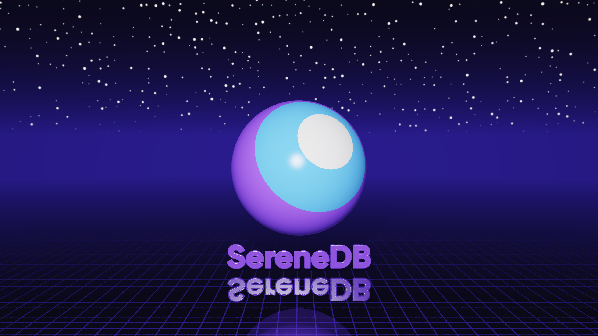

# raytracer-demo

A database draws a 3D picture: the SereneDB logo as a planet under a starry sky, ray traced by
**one SQL query** running inside SereneDB, live on the laptop.



## Why it's cool (for the pitch)

> This picture was drawn by a database. There is no graphics card or 3D engine involved: it is
> one SQL query where every pixel is a row, and SereneDB traces the light rays across every
> core of this laptop. ClickHouse wrote a ray tracer like this to show off its engine. DuckDB
> can't run it at all, and CedarDB runs it 33 times slower than ClickHouse. SereneDB is built on
> the DuckDB engine, which we have forked and hardened, and it draws this picture **3 times faster
> than ClickHouse**, with the same query and pixel-for-pixel the same image. It's the same engine
> that runs our customers' analytics, search and vector queries.

## Instructions for the meeting

You need: the laptop, **Docker Desktop** installed, and this folder.

**Before the meeting** (with internet, takes ~5 minutes, do it once):

1. Open **Docker Desktop** and wait until it says it's running.
2. Open the **Terminal** app.
3. Type `cd ` (with a space), drag this folder into the Terminal window, press **Enter**.
4. Type `./demo.sh prepare` and press **Enter**. Wait for **"All good. You are ready for the demo."**

**In the meeting** (no internet needed):

1. Make sure **Docker Desktop** is running.
2. In the Terminal (in this folder, see step 3 above), type one of these and press **Enter**:
   - `./demo.sh` — SereneDB draws the picture (a few seconds), and it opens by itself.
   - `./demo.sh race` — SereneDB draws it, then ClickHouse draws the same picture with the same
     query, and the Terminal shows who was faster. Both pictures open at the end.

If anything goes wrong, the finished pictures are in the `images` folder: just open one.

Want the light version? Put it in front of the command: `THEME=light ./demo.sh`.

After the meeting: `./demo.sh stop` frees the laptop's memory.

## Cheat sheet

Run from this folder.

| Command | What it does |
|---|---|
| `./demo.sh prepare` | download SereneDB and ClickHouse, quick test run (needs internet) |
| `./demo.sh` | SereneDB draws the picture and opens it |
| `./demo.sh race` | SereneDB, then ClickHouse, draw the same picture; prints the times, opens both |
| `./demo.sh stop` | stop both database containers |
| `./preview.sh` | quick render of the dark and the light picture, each opens when it's ready |
| `THEMES=dark ./preview.sh` | only one of them |
| `./preview.sh final` | re-render the 2560x1440 backups in `images/` (about a minute each) |
| `open images/*.png` (Mac) or `for f in images/*.png; do xdg-open "$f"; done` (Linux) | look at the backups |

Options go in front of a command, e.g. `THEME=light WIDTH=1920 HEIGHT=1080 ./demo.sh race`:

| Option | Values | Default |
|---|---|---|
| `THEME` | `dark`, `light` | `dark` |
| `WIDTH`, `HEIGHT` | picture size in pixels | `1280`, `720` |
| `SAMPLES` | rays per pixel: higher is smoother and slower | `2` |
| `SERENEDB_IMAGE`, `CLICKHOUSE_IMAGE` | Docker images | `serenedb/serenedb:latest`, `clickhouse/clickhouse-server:26.9` |

`preview.sh` takes `THEMES` (a space-separated list), `WIDTH`, `HEIGHT` and `SAMPLES`.

Where to change the design, all in `gen.py`:

| What | Where |
|---|---|
| sky, floor, grid colors, shadow strength, exposure | `THEMES` |
| how matte, glossy or mirror-like every object is | `MATERIALS` |
| the planet's size and the wordmark under it | `PLANET` |
| the stars: how dense, how big (how bright is `stars` in `THEMES`; the light sky has none) | `STARS` |
| how they are put together | `layout()` |
| the wordmark's tube thickness | `TITLE` |
| camera | `--fov`, `--elevation` of `gen.py`; how much room is left around the scene is `FRAME` |

The wordmark comes from the logo SVG (`wordmark.py`).

## Measured

1920 x 1080, 2 samples per pixel, 3 bounces, an Apple M1 Pro laptop with Docker Desktop given
8 CPUs, both engines in Docker, the same picture down to the last pixel. ClickHouse runs with the
settings its own [RayTracer](https://github.com/ClickHouse/RayTracer) queries use
(`max_block_size = 2048, optimize_and_compare_chain = 0`); SereneDB with its defaults.

| Engine | Time |
|---|---:|
| SereneDB 26.10.2 | 3.2 s |
| ClickHouse 26.9.22.3 | 14.5 s |

Another machine will give other numbers; the ratio is what matters.

## How it works

`gen.py` writes the query. It is the same scene for SereneDB and for ClickHouse; only the SQL
spelling differs (macros vs `WITH` lambdas, `list_transform` vs `arrayMap`, ...):

- every `(pixel, sample)` is a row of `range(width * height * samples)`;
- the vectors are tuples of three doubles;
- a ray's bounces are a fold (`list_reduce` / `arrayFold`) over `range(depth)` whose state is the
  ray: origin, direction, throughput, collected color;
- "SereneDB" is the real wordmark from the logo SVG (`wordmark.py`): each letter is filled with
  tubes (capsules) clipped to its outline, plus a tube along the outline for the rounded edge;
  the tubes are binned into a grid of the text plane, so a ray only tests the tubes in the cells
  it actually passes through;
- the planet is one ball with the SereneDB mark painted on the side facing the camera;
- the stars are in the sky, not in the scene: a ray that misses everything looks up which cell of
  (azimuth, height) it points at, and a hash of the cell decides whether a star sits there, where,
  how bright and how warm. Only rays straight from the camera see them, so the polished floor
  does not fill up with reflected stars;
- `GROUP BY pixel` averages the samples, and `png.py` turns the `pixel, r, g, b` rows into a PNG.

```bash
python3 gen.py --dialect serenedb --width 1920 --height 1080 --samples 4 > scene.sql
```
