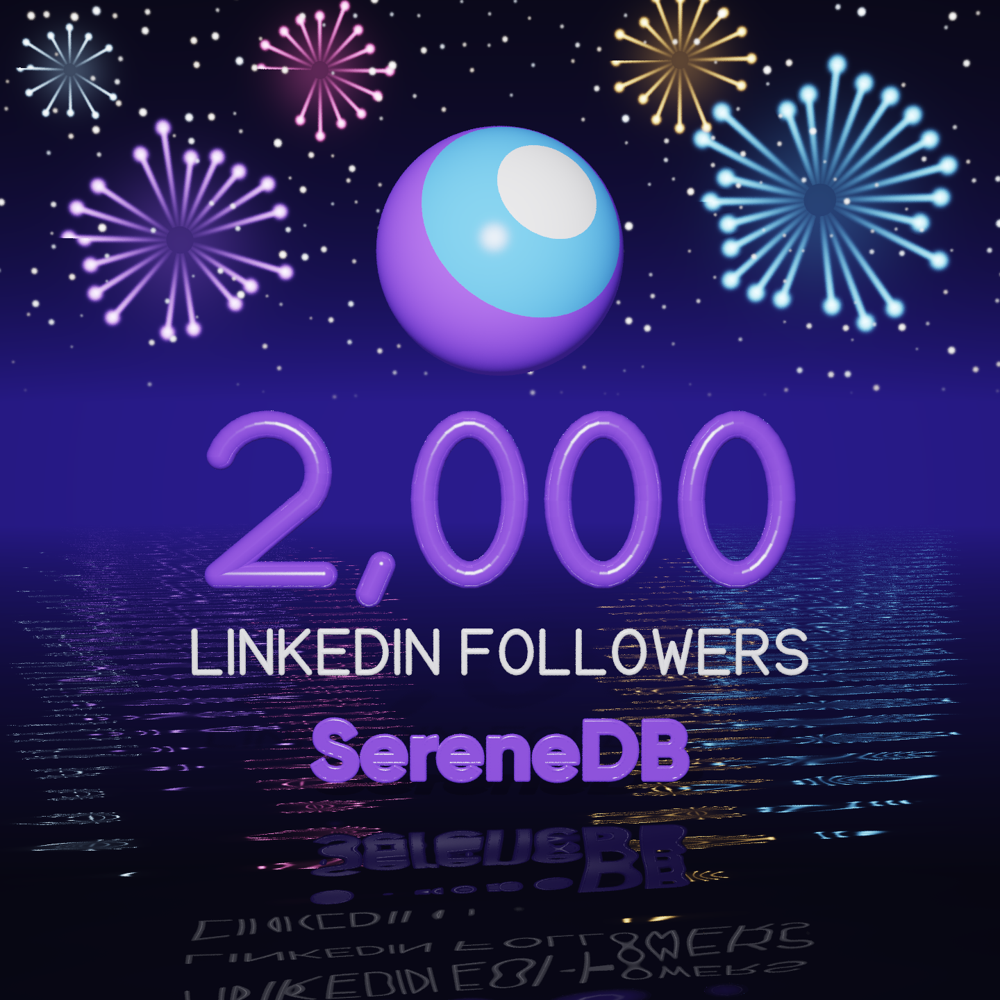

# raytracer-demo

A database draws a 3D picture: the SereneDB logo as a planet under a starry sky, ray traced by
**one SQL query** running inside SereneDB.


## Why it's interesting

This picture is drawn by a database. There is no graphics card or 3D engine involved: it is one
SQL query where every pixel is a row, and SereneDB traces the light rays across every core of the
machine. ClickHouse wrote a ray tracer like this to show off its engine. SereneDB, built on the
DuckDB engine that we have forked and hardened, draws this picture **more than 4 times faster
than ClickHouse**, with the same query and pixel-for-pixel the same image, and in less memory.
DuckDB 2.0 runs out of 16 GB before it draws a pixel, and CedarDB cannot run the query at all.

## Running it

You need Docker (Docker Desktop on a Mac) and python3.

```bash
./demo.sh prepare   # once, with internet: download both engines, test run
./demo.sh           # SereneDB draws the picture and opens it
./demo.sh race      # SereneDB, then ClickHouse, the same picture; prints both times
./demo.sh stop      # stop both containers
```

If anything goes wrong, the finished pictures are in `images/`.

## Cheat sheet

Run from this folder.

| Command | What it does |
|---|---|
| `./demo.sh prepare` | download SereneDB and ClickHouse, quick test run (needs internet) |
| `./demo.sh` | SereneDB draws the picture and opens it |
| `./demo.sh race` | SereneDB, then ClickHouse, draw the same picture; prints the times, opens both |
| `./demo.sh stop` | stop both database containers |
| `./preview.sh` | quick render of the dark and the light picture, each opens when it's ready |
| `THEMES=dark ./preview.sh` | only one of them |
| `./preview.sh final` | re-render the 2560x1440 backups in `images/` (about a minute each) |
| `open images/*.png` (Mac) or `for f in images/*.png; do xdg-open "$f"; done` (Linux) | look at the backups |
| `SCENE=milestone ./demo.sh race` | the race on the LinkedIn picture instead of the planet |
| `./linkedin/render.sh` | re-render the LinkedIn picture and its query in `linkedin/` |

Options go in front of a command, e.g. `THEME=light WIDTH=1920 HEIGHT=1080 ./demo.sh race`:

| Option | Values | Default |
|---|---|---|
| `THEME` | `dark`, `light` | `dark` |
| `WIDTH`, `HEIGHT` | picture size in pixels | `1280`, `720` |
| `SAMPLES` | rays per pixel: higher is smoother and slower | `2` |
| `SCENE` | `planet`, `milestone` (the LinkedIn picture) | `planet` |
| `OPEN` | `0` leaves the pictures closed, for runs nobody watches | `1` |
| `SERENEDB_IMAGE`, `CLICKHOUSE_IMAGE` | Docker images | `serenedb/serenedb:latest`, `clickhouse/clickhouse-server:26.10` |

`preview.sh` takes `THEMES` (a space-separated list), `WIDTH`, `HEIGHT` and `SAMPLES`.

Where to change the design, all in `gen.py`:

| What | Where |
|---|---|
| sky, floor, grid colors, shadow strength, exposure | `THEMES` |
| how matte, glossy or mirror-like every object is | `MATERIALS` |
| the planet's size and the wordmark under it | `PLANET` |
| the stars: how dense, how big (how bright is `stars` in `THEMES`; the light sky has none) | `STARS` |
| how they are put together | `layout()` |
| the wordmark's tube thickness | `TITLE` |
| camera | `--fov`, `--elevation` of `gen.py`; how much room is left around the scene is `FRAME` |
| the LinkedIn picture: its number and caption, fireworks, the lake | `MILESTONE`, `FIREWORKS`, `WATER`, `layout_milestone()` |

The wordmark comes from the logo SVG (`wordmark.py`); other text is in the tubes of `font.py`.

## Measured

Both engines in Docker on one laptop, an Intel Core i7-8550U (4 cores, 8 threads) with 46 GB,
measured 2026-10-30. 2 samples per pixel, 3 bounces; the race with the middle ratio of three,
the range of all three in brackets. Both engines return the same picture down to the last pixel. ClickHouse runs with
the settings its own [RayTracer](https://github.com/ClickHouse/RayTracer) queries use
(`max_block_size = 2048, optimize_and_compare_chain = 0`); SereneDB with its defaults.

| Scene | SereneDB 26.10.7 | ClickHouse 26.10.3.7 | |
|---|---:|---:|---:|
| planet, 1920 x 1080 | 8.1 s (8.1-9.8) | 38.3 s (38.3-43.1) | 4.7x |
| milestone, 1080 x 1080 | 8.4 s (8.0-10.2) | 38.9 s (38.9-45.8) | 4.6x |

Memory, peak of each container during the planet render (cgroup `memory.peak`, the engine at
rest included: 0.33 GB for SereneDB, 0.36 GB for ClickHouse):

| | Peak memory |
|---|---:|
| SereneDB 26.10.7 | 1.47 GB |
| ClickHouse 26.10.3.7 | 1.62 GB |

The others, each given 60 seconds and 16 GB (`docker run --memory 16g --memory-swap 16g`):

- **DuckDB 2.0.0** runs SereneDB's query as it is, with `SET lambda_syntax = 'ENABLE_SINGLE_ARROW'`
  for the `->` lambdas. It is killed for running out of 16 GB after 21 s, at 1920 x 1080 and at
  32 x 18 alike: it never gets to a pixel.
- **CedarDB v2026-10-22** cannot run the query: it has no macros and no lambdas. ClickHouse's own
  CedarDB port of its terrain scene (in their RayTracer repository) fails at 1920 x 1080 with
  `unable to allocate working memory` after reaching 9.2 GB. ClickHouse's README reports it 33x
  slower than ClickHouse where it does finish.

Another machine will give other numbers; the ratio is what matters.

## LinkedIn: 2,000 followers

`linkedin/` holds the picture for the post (`milestone.png`, 1440 x 1440, 6 samples per pixel),
the query SereneDB drew it with (`milestone.sql`) and the script that does both (`render.sh`).
The scene is `--scene milestone` of `gen.py`: the planet, the
number, the caption and the wordmark over a lake, fireworks in the sky. The lake reflects
little, but the fireworks it reflects are made brighter, so they still glow in the water.



## How it works

`gen.py` writes the query. It is the same scene for SereneDB and for ClickHouse; only the SQL
spelling differs (macros vs `WITH` lambdas, `list_transform` vs `arrayMap`, ...):

- every `(pixel, sample)` is a row of `range(width * height * samples)`;
- the vectors are tuples of three doubles;
- a ray's bounces are a fold (`list_reduce` / `arrayFold`) over `range(depth)` whose state is the
  ray: origin, direction, throughput, collected color;
- "SereneDB" is the real wordmark from the logo SVG (`wordmark.py`): each letter is filled with
  tubes (capsules) clipped to its outline, plus a tube along the outline for the rounded edge;
  the tubes are binned into a grid of the text plane, so a ray only tests the tubes in the cells
  it actually passes through;
- the planet is one ball with the SereneDB mark painted on the side facing the camera;
- the stars are in the sky, not in the scene: a ray that misses everything looks up which cell of
  (azimuth, height) it points at, and a hash of the cell decides whether a star sits there, where,
  how bright and how warm. Only rays straight from the camera see them, so the polished floor
  does not fill up with reflected stars;
- `GROUP BY pixel` averages the samples, and `png.py` turns the `pixel, r, g, b` rows into a PNG.

```bash
python3 gen.py --dialect serenedb --width 1920 --height 1080 --samples 4 > scene.sql
```
